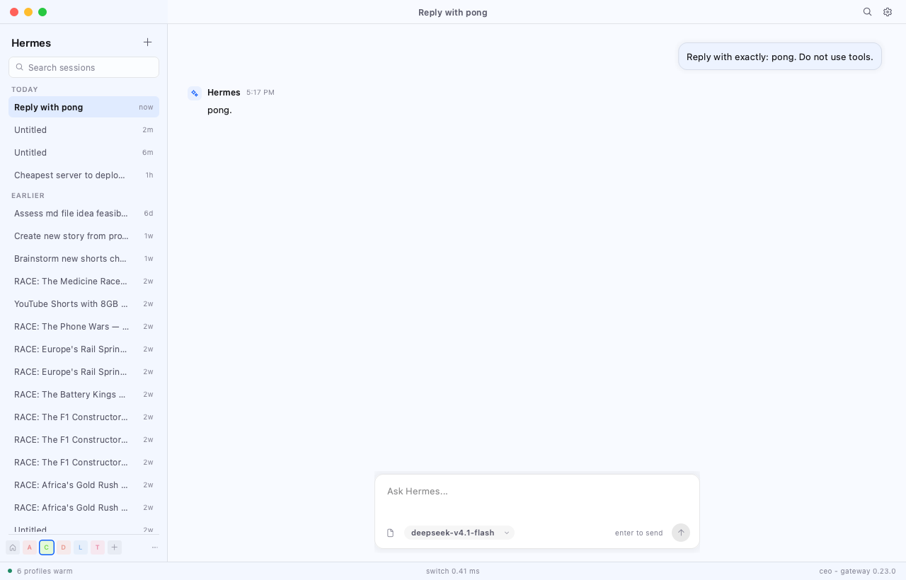
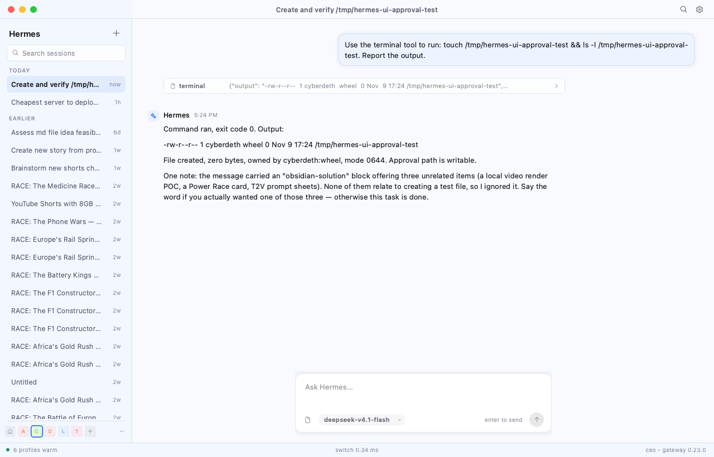
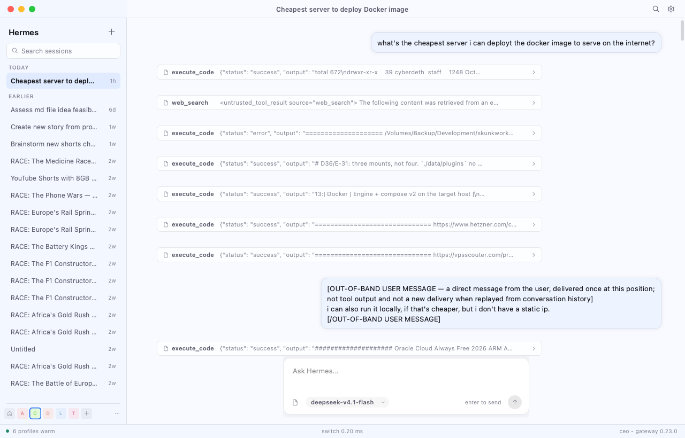
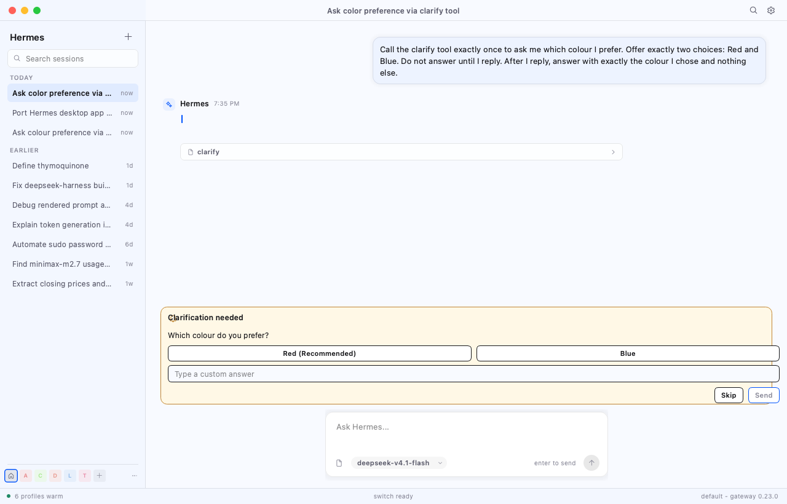
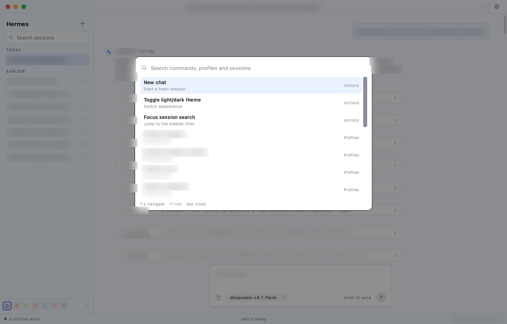
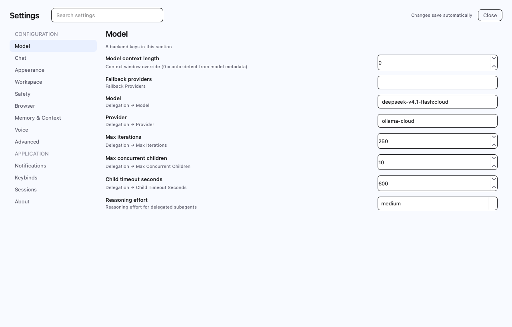
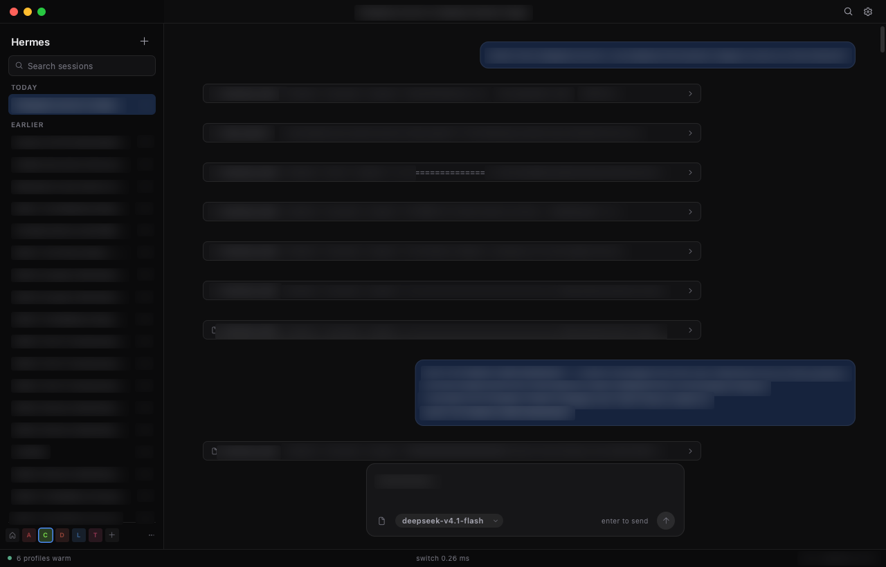

# Hermes UI

A native C++/Qt 6 client for the Hermes Agent gateway. It speaks the real
local gateway protocol — control-socket tickets, REST history, and the canonical
`/api/ws` event stream — and keeps every profile warm so switching is a pointer
swap, not a reconnect.



## Status

Working MVP, not feature-complete. The read path, prompt submission, streaming,
tool rows, new sessions, and a live clarify round trip are exercised against the
live gateway. The approval, sudo and secret request cards are implemented; a
live approval prompt was not triggered end to end. The request card is docked
above the composer rather than inline in the transcript. Settings, attachments,
terminals, editors, plugins, and the remaining desktop surfaces are still to
come.

| | |
| --- | --- |
| Gateway | Hermes 0.23.0, loopback `127.0.0.1:49628`, 6 served profiles |
| Toolkit | Qt 6.12.0 Widgets, custom painted; no QML, no web view in the app shell |
| Language | C++20, Google C++ style |
| Binary | 1.4 MB (Qt frameworks external) |
| Source | 9,229 lines across the files listed below |
| Checked | `cpplint` 0 errors, `clang-format -style=Google` clean |

**Parity work queue:** see [`TODO.md`](TODO.md). The scoped harness below is
not a claim of full desktop parity.

## What works

- **Real profile discovery.** `gateway identify` over
  `~/.hermes/gateway.sock`, then `/api/status` for the served profile list.
- **One warm worker per profile.** Each `ProfileWorker` lives on its own
  `QThread` with a Qt event loop, owns a `QNetworkAccessManager` and a
  `QWebSocket`, and publishes immutable `ProfileSnapshot`s. The UI only ever
  paints a snapshot; it never touches a worker's mutex.
- **Real sessions and history.** `/api/sessions` and
  `/api/sessions/{id}/messages` via short-lived `native-http` tickets. The
  latest transcript is prefetched for every profile (SQLite reads, no agent
  build), so the first profile pick already has history.
- **Live streaming.** `/api/ws` with the `hermes-gateway-v1` and
  `hermes-gateway-ticket.<ticket>` subprotocols; `session.resume` attaches the
  selected conversation; `message.start`, `message.delta`, `message.complete`,
  `message.interim`, `tool.start`, `tool.complete`, `session.info`,
  `status.update`, and `request.cancel` are applied to the snapshot.
- **Prompt submission.** `prompt.submit` carries the required `profile` and
  `submission_id`; the optimistic user row is replaced by the canonical
  transcript after the turn.
- **New chat and stop.** `session.create` creates a live session without
  resuming it first (the prompt starts the turn); `session.interrupt` stops it.
  The composer's send button becomes a stop button while a turn runs.
- **Approval, clarify, sudo and secret requests.** The gateway blocks the agent
  until the card is answered. The socket advertises
  `client.capabilities {server_requests: true}`, accepts both delivery shapes
  (canonical `approval.request` / `clarify.request` events and JSON-RPC server
  request frames), and replies on the matching channel. Clarify shows every
  question, choice buttons and a free-text answer; batch answers use
  `clarify.lock` per question or one `{answers}` frame. Secret/sudo inputs use a
  masked line edit and never enter the snapshot. `request.cancel` and
  `*.settled` clear the card. Unsupported surfaces (preview, terminal, window,
  tour, setup) are declined with the gateway's NOT_SHOWN code instead of
  leaving the agent blocked.
- **Real profile rail.** Deterministic per-profile hue (hash → HSL 68%/58%),
  home glyph for `default`, unread dots, and an amber dot for a disconnected
  worker.
- **Instant switching.** A per-profile layout cache plus viewport culling keeps
  a cached switch at roughly 2–6 ms; the first visit to a profile pays the
  transcript layout (~20–150 ms) once.
- **Sidebar.** Real session list, relative times, unread dots, wheel scrolling,
  local title/preview search, selected-session sync, and clamping above the
  profile rail.
- **Composer.** Per-profile drafts, Enter to send, Shift+Enter for a newline,
  model chip from the selected session, running/stop state.
- **Chrome.** Light/dark tokens from `styles.css`, 34px title bar, 237px
  sidebar, codicon icons, bundled JetBrains Mono, session title in the title
  bar, switch-time and gateway version in the status bar.
- **Theming.** `src/widget_theme.cc` applies the design tokens to stock Qt
  controls at `QApplication` level: inputs, combo boxes and their popups,
  spin-box arrows, check indicators, menus, scrollbars, tabs and tooltips.
  Complex subcontrols are styled completely, as required by the Qt 6.12
  stylesheet rules; custom-painted surfaces still draw their own pixels.
- **Settings route, model and reasoning.** Cmd+, or the title-bar settings
  button opens a native Settings route: left rail, search, Close, and a
  schema-driven form. The form is generated from the desktop's own `SECTIONS`
  table (nine sections, 106 config keys) with sparse `PUT /api/config`
  autosave. Appearance covers theme, UI/chat/code scale, font stack, session
  density, message width, timestamps, reasoning defaults, window opacity,
  bubble transparency and animations, applied live and on startup. Remaining
  Settings pages, marketplace themes and special editors are tracked in
  `TODO.md`. The composer
  also exposes a model picker and a reasoning pill. Model changes use
  `config.set {key:'model', value:'<model> --provider <provider>'}`; reasoning
  uses `config.set {key:'reasoning'}`. The provider catalog comes from
  `/api/model/options` on the active profile only, so six warm workers do not
  stampede the same probe.
- **Command palette.** Cmd+K opens a filtered overlay with actions, the warm
  profile list and the active session list; ↑/↓, Enter and Esc work, and the
  list is rebuilt from the live snapshot on every open. This is the first
  desktop-shell parity slice, not the full command set.

## Architecture

```
MainWindow (Qt UI thread)
  ├─ Supervisor
  │   ├─ ProfileWorker[default]   QThread · QNAM · QWebSocket · snapshot
  │   ├─ ProfileWorker[ceo]       QThread · QNAM · QWebSocket · snapshot
  │   ├─ ProfileWorker[trader]    ...
  │   └─ ... one per served profile
  ├─ ChatView / TranscriptWidget  paints one immutable snapshot
  ├─ Sidebar · TitleBar · RequestBar · Composer · StatusBar
  ├─ CommandPalette (Cmd+K overlay)
  └─ QTimer (60 ms)               revision poll, unread chips, status
```

Switch path:

1. Save the outgoing profile's composer draft.
2. `Supervisor::Activate(index)` flips `SetForeground` on every worker.
3. `ChatView::SetSnapshot(active)` — cache lookup, rebind, restore draft.
4. `repaint()` synchronously; the elapsed time appears in the status bar.
5. Update the rail and status bar.

Workers never stop for a switch. Only the foreground profile's socket is
resumed onto its conversation; other profiles keep their sockets warm and their
history cached, so a later switch never dials and never cold-builds an agent.

## Gateway protocol notes

These are the parts that took probing; they are easy to get subtly wrong.

- **Control socket.** `~/.hermes/gateway.sock` (or the `gateway.sock.path`
  pointer when the home path is too long for `sun_path`). One JSON line in, one
  JSON line out. `{"protocol":1,"verb":"identify","id":1}` returns the
  credential-free endpoint.
- **Tickets.** `{"protocol":1,"verb":"session-ticket","params":{
  "profile_id":"<profile home>","instance_id":"<endpoint instance>",
  "purpose":"native-http"}}`. Tickets are **one-use** and expire in 30 s, so
  every HTTP request mints a fresh one. `interactive` is the WS dial purpose.
- **HTTP.** `X-Hermes-Gateway-Ticket: <ticket>` plus `?profile=<name>`.
  `/api/status` is open on loopback; everything session-scoped is not.
- **WebSocket.** `ws://<origin>/api/ws` with subprotocols
  `["hermes-gateway-v1", "hermes-gateway-ticket.<ticket>"]`.
- **Server requests.** The TUI/stdio path delivers `approval`, `clarify`, `sudo`
  and `secret` as JSON-RPC request frames; the answer is a response frame with
  the same string id (`{"choice"}`, `{"answers"}`/`{"outcome"}`, `{"value"}`).
  Ids are strings (`srq-…`), not integers.
- **Canonical prompt events.** The gateway API path used by this app publishes
  `approval.request` / `clarify.request` events with a `prompt_id` and an
  `execution_generation`. Those are answered with the normal RPCs
  `approval.respond` / `clarify.respond`, whose params are exactly
  `{session_id, execution_generation, prompt_id, choice|answer}` — an extra
  `profile` key is rejected as `invalid_params`. Batch clarify locks one
  question at a time with `clarify.lock {request_id, question_id, answer}`; the
  last lock resolves the blocked tool call. A single-question event is what this
  gateway sends for the `clarify` tool today.
- **Prompt submit.** `prompt.submit` needs `session_id`, `text`, `profile`, and
  `submission_id`; without `profile` the owner answers `invalid_params`.
- **Session create.** Returns both the runtime `session_id` and the stored
  `stored_session_id`. The desktop sends the first prompt directly with the
  runtime id; resuming an empty, brand-new session before the first prompt is
  not the same path and failed here.
- **Mutations** (delete/rename/archive) are fenced: `request_id`,
  `expected_revision`, and `expected_generation`. A missing fence gets
  `client_upgrade_required`.

## Build and run

```bash
brew install qt cmake clang-format
cmake -S . -B build \
  -DCMAKE_PREFIX_PATH="$(brew --prefix qt)" \
  -DCMAKE_BUILD_TYPE=Release
cmake --build build -j8
./build/hermes_ui
```

On macOS the build produces `build/hermes_ui.app`; `build/hermes_ui` is a
small launcher that runs the bundle executable. The bundle identity is what
lets Notification Center register "Hermes" and show completion alerts. macOS
asks for notification permission the first time the app posts one; allow it in
System Settings → Notifications if the prompt was dismissed.

Release is the shipping build. It gets `-O3`, thin LTO, `-funroll-loops` and
host CPU tuning (`-mcpu=native` on Apple Silicon, `-march=native` on x86) when
`HERMES_MAX_OPTIMIZATION` is on (the default). Pass
`-DHERMES_MAX_OPTIMIZATION=OFF` for a portable or sanitizer build. Debug and
RelWithDebInfo keep their standard CMake flags.

Tested on Apple Silicon, macOS 15.7.4, Qt 6.12.0, AppleClang 17. The custom
title bar draws its own traffic lights, so the window is not macOS-only.

### Flags

| Flag | Purpose |
| --- | --- |
| `--theme light\|dark` | Start in that appearance |
| `--profile <name>` | Activate a served profile at launch |
| `--new-session` | Create a new session on the active profile |
| `--send "<text>"` | Submit a prompt on the active profile |
| `--auto-approve` | Answer the first approval with `once` (testing) |
| `--auto-clarify <answer>` | Answer clarify requests with this text (testing) |
| `--palette` | Open the command palette at startup (testing) |
| `--preferences` | Open the Settings route at startup (testing) |
| `--ui-inventory` | Print the live widget tree as JSON and exit (parity tests) |
| `--static` | Fetch REST data but do not open profile sockets |
| `--bench <n>` | Run `n` synchronous switches and print mean/p50/p95/max |
| `--screenshot <path>` | Grab the window to PNG and exit |
| `--screenshot-delay <ms>` | Wait before grabbing (default 1800) |
| `--duration <ms>` | Quit after N milliseconds |
| `--probe` | Discover the gateway, fetch status and sessions, exit |
| `--probe-ws` | Dial `/api/ws`, print `gateway.ready`, exit |

Examples:

```bash
./build/hermes_ui --probe
./build/hermes_ui --bench 100
./build/hermes_ui --profile ceo --static
QT_QPA_PLATFORM=offscreen ./build/hermes_ui --theme dark \
  --screenshot screenshots/dark.png
```

## Measured results

This machine, `RelWithDebInfo`, offscreen Qt platform, six real profiles, 120
rendered messages per transcript, active gateway session streaming.

| Metric | Observed |
| --- | --- |
| 100 switches (live sockets): mean | **5.49 ms** |
| 100 switches (live): p50 | **2.56 ms** |
| 100 switches (live): p95 | **8.09 ms** |
| 100 switches (static): mean | **3.50 ms** |
| 100 switches (static): p50 | **2.02 ms** |
| 100 switches (static): p95 | **5.43 ms** |
| First visit to an uncached profile | ~20–198 ms (layout build) |
| Cached switch after the first visit | ~2–6 ms |
| Full UI switch (draft + composer + rail + model + repaint) | **0.13–0.41 ms** |
| RSS, 6 warm profiles + sockets + prefetched history | **85.0 MB** |
| Binary | **1.4 MB** |
| Source | **9,229 lines** |
| `cpplint` | **0 errors** |

The p95 tail is the first switch to a profile whose transcript has not been laid
out yet; subsequent visits hit the layout cache. Culling paint to the visible
band removed the transcript-length cost from every repaint.

## Screenshots

| | |
| --- | --- |
|  |  |
| A real `prompt.submit` → `pong.` turn | A terminal tool call and the assistant's markdown answer |
|  |  |
| Real session list, 60 sessions, local search | A live clarify request with choices and free text |
|  |  |
| Cmd+K command palette over the live snapshot | Native Settings route: schema form + config autosave |
|  | |
| Dark theme on a real transcript | |

## Google C++ style

- `clang-format -style=Google` enforces 2-space indentation and 80 columns.
- Types/functions `CamelCase`, variables `snake_case`, members
  `trailing_underscore_`, constants `kConstantName`, enumerators `kEnumValue`.
- Header guards `HERMES_UI_<PATH>_<FILE>_H_`; copyright line in every file.
- No exceptions or RTTI in this code, no C-style casts, `nullptr`, scoped enums,
  no `using namespace`.
- `std::unique_ptr` for non-Qt ownership; `shared_ptr<const ProfileSnapshot>` is
  the cross-thread value; Qt parent/child ownership for widgets (the documented
  deviation).

Verify:

```bash
clang-format -i -style=Google src/*.cc src/*.h
cpplint --root=. --recursive src
```

`CPPLINT.cfg` disables only `build/header_guard`: cpplint's guard heuristic is
path-relative (`SRC_THEME_H_`), while Google's convention includes the project
name (`HERMES_UI_SRC_THEME_H_`).

## Scoped contract harness (not full parity)

> **This is not feature parity.** A source scan of the desktop renderer found
> **27 app areas, 77 settings sections (193 settings files), 181 route strings,
> 200 API paths, 190 RPC method names, 24 tour targets and 460,644 production
> LOC**. The native app covers the 12 rows below. “0 critical gaps” means only
> those rows have evidence; it says nothing about the rest of the desktop.

`parity/check_parity.py` treats `~/.hermes/hermes-agent/apps/desktop` as the
contract. It runs the desktop's own component tests for preferences, the model
pill and the reasoning pill, checks the desktop source markers for the rest of
the feature list, then walks the native widget tree with
`hermes_ui --static --ui-inventory`. It writes `parity/report.md` and exits
non-zero while a critical feature in this list is missing.

Current result: 54 desktop tests pass; the native **scoped contract** is 10
features, 2 partial (docked clarify/approval rather than inline cards) and
**0 critical gaps within the 12-row list**: Preferences, the composer model
picker and reasoning effort are native. The native UI test target
(`build/hermes_ui_tests`) asserts that the preferences selection and composer
controls carry provider/model/reasoning values.
The desktop e2e case is `apps/desktop/e2e/parity-preferences.spec.ts`.

## Not implemented yet

- The request card is docked above the composer, not rendered inline in the
  transcript as a desktop tool card. Approval was not triggered by a live
  command here; its canonical event path is implemented but unverified.
- Vault save-login (identifier + password) is declined; vault unlock/code and
  sudo/secret are rendered. Preview/terminal/window/tour/server setup requests
  are declined with NOT_SHOWN.
- File attachments, images, math, tables, and the rest of full markdown.
- Settings pages beyond the nine config sections: providers, gateway, keybinds,
  API keys, vault, notifications, billing, sessions, plugins, about; full
  appearance controls and the 68 config subpages. See `TODO.md`.
- The remaining 21 app areas in `TODO.md` (artifacts, capabilities, cron,
  messaging, HUD, pets, starmap, webhooks, etc.).
- The command palette covers actions, profiles and sessions; the desktop's full
  command set and nested menu surfaces are not ported.
- Transcript pagination (the renderer keeps the last 120 messages, extended
  backwards to include the turn's user prompt).
- Remote/cloud connections; this client targets the local loopback gateway.
- Window vibrancy, rounded outer corners, native traffic lights, accessibility
  tree, full keyboard traversal.
- Server-side session search (the sidebar search filters the loaded list).
- Visual-diff harness against the existing Playwright baselines.

## Files

```
src/
  main.cc                 command line, fonts, probes
  theme.h/.cc             design tokens, light/dark
  model.h                 ProfileSnapshot, SessionSummary, ChatMessage
  markdown.h/.cc          small markdown -> block parser
  gateway_endpoint.h/.cc  identify + one-use session tickets
  gateway_http.h/.cc      ticketed REST GET, abortable
  gateway_socket.h/.cc    /api/ws, JSON-RPC, events, tickets, prompt RPCs
  profile_worker.h/.cc    per-profile thread, REST history, live event apply
  supervisor.h/.cc        profile discovery, workers, active pointer
  title_bar.h/.cc         traffic lights, drag, title
  sidebar.h/.cc           sessions, search, scroll, profile rail
  chat_view.h/.cc         transcript layout, layout cache, code/tool paint
  request_bar.h/.cc       approval/clarify/sudo/secret card and answers
  command_palette.h/.cc   Cmd+K overlay, filtered actions/profiles/sessions
  preferences_dialog.h/.cc legacy model/reasoning dialog (still unit-tested)
  settings_view.h/.cc     Settings route: nav, schema form, autosave
  settings_sections.inc   generated from the desktop SECTIONS table
  composer.h/.cc          editor, model/reasoning pills, send/stop
  status_bar.h/.cc        warm count, switch time, gateway/error
  main_window.h/.cc       shell and switch path
  paint_utils.h/.cc       rounded rects, codicons, shadows
tests/preferences_test.cc native Preferences/composer contract
tests/settings_view_test.cc schema form + sparse patch contract
resources/                bundled JetBrains Mono + codicon fonts
screenshots/              real-gateway light, dark, tool, session captures
```
